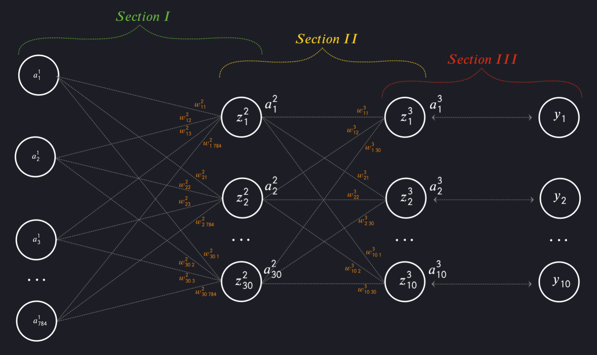

Before we begin converting more complex summation formulas into vectorized form, let's practice using the neural network architecture introduced by Michael Nielsen. For our first exercise, we will apply the corresponding transformation to each block separately



To begin, let us practice with basic transformations that sequentially comprise three main stages:

1. Visualization of the neural network segment under consideration;
2. Problem formulation and writing the equation in index notation (for an individual element) describing a specific matrix operation or loss function;
3. Transition from index notation to the vectorized (matrix) form of the equation.

# Section III 
1. The first stage of our plan has already been implemented in the figure above. Now, moving from right to left (in the direction of backpropagation), we need to provide a rigorous mathematical description of each element.

2. In Section III, it is appropriate to define the loss function. Let us begin with the standard mean squared error (MSE) loss function. In index notation it is written as follows:

$$
C = 0.5 \sum_{i=1}^{10} (y_i - a_i)^2 = 0.5 \left[ (y_1 - a_1)^2 + (y_2 - a_2)^2 + \dots + (y_{10} - a_{10})^2 \right]
$$
Suppose, that:
$$
\quad 
Y = \left[ y_1, y_2, y_3, \dots, y_n \right] 
\quad 
A = \left[ a_1, a_2, a_3, \dots, a_n \right]
$$

<i> Optional: </i>
$$
M = [ m_1, m_2, \dots, m_n] and S = \sum_{i=1}^{n} m_i^2$ then S = m_1 \cdot m_1 + m_2 \cdot m_2 + \dots m_n \cdot m_n
$$


and the vector representation of S is
$$
S = \begin{pmatrix} 
m_1 & m_2 & \dots & m_n \end{pmatrix} 
@ 
\begin{pmatrix} m_1 \\ m_2 \\ \dots \\ m_n \end{pmatrix} 
\quad
$$
So, in this case:


# Problem 1

Consider three consecutive matrix-vector multiplications for a single training example $x$:

$z^1 = w^1 a^0, \quad z^2 = w^2 z^1, \quad z^3 = w^3 z^2$

Here, $w^1, w^2, w^3$ are 2D weight matrices, and $a^0$ is a 1D input vector.

Let $n^0, n^1$, and $n^2$ be the number of neurons in layers 0, 1, and 2, respectively. Using summation notation $\sum$ (analogous to nested `for` loops), write a formula to compute a single output element $z_i^3$ directly in terms of the elements of $a_l^0$ and the weight matrices $w^1, w^2, w^3$.

<i> <b> Index notation: </b>
<div align="center">
  
  $z_i^3 = \sum_{j=1}^{n^2} \left[ w_{ij}^3 \cdot \sum_{k=1}^{n^1} \left[ w_{jk}^2 \cdot \sum_{l=1}^{n^0} w_{kl}^1 a_l^0 \right] \right]$

</div>

<b> Matrix notation: </b>

$$
z_i^3 = 
\begin{pmatrix} 
w_{i\,1}^3 & w_{i\,2}^3 & \dots & w_{i\,n^2}^3 
\end{pmatrix} 
\cdot 
\begin{pmatrix} 
w_{1\,1}^2 & w_{1\,2}^2 & \dots & w_{1\,n^1}^2 \\\\ 
w_{2\,1}^2 & w_{2\,2}^2 & \dots & w_{2\,n^1}^2 \\\\ 
\dots & \dots & \ddots & \dots \\\\ 
w_{n^2\,1}^2 & w_{n^2\,2}^2 & \dots & w_{n^2\,n^1}^2 
\end{pmatrix} 
\cdot 
\begin{pmatrix} 
w_{1\,1}^1 & w_{1\,2}^1 & \dots & w_{1\,n^0}^1 \\\\ 
w_{2\,1}^1 & w_{2\,2}^1 & \dots & w_{2\,n^0}^1 \\\\ 
\dots & \dots & \ddots & \dots \\\\ 
w_{n^1\,1}^1 & w_{n^1\,2}^1 & \dots & w_{n^1\,n^0}^1 
\end{pmatrix} 
\cdot 
\begin{pmatrix} 
a_1^0 \\\\ 
a_2^0 \\\\ 
\dots \\\\ 
a_{n^0}^0 
\end{pmatrix}
$$

Python implimentation:
</i>

```python
import numpy as np

def feedforward_linear(a, weights):
    for w in weights:
        a = np.dot(w, a)
    return a
```
# Problem 2
Consider a two-layer forward pass for a single training example, defined by the following chain of functions:

$a^1 = f^1(z^1), \quad z^2 = g^2(a^1), \quad C = h(z^2)$

Here, $f^1$ and $g^2$ are vector-valued functions where <b>each</b> output element depends on <b>all</b> of its inputs (such as <b>Softmax</b>).

First, express the derivative $\frac{\partial C_x}{\partial z_{xp}^1}$ using nested sums $\sum$ in terms of the partial derivatives at each step: $\frac{\partial C_x}{\partial z_{xk}^2}$, $\frac{\partial z_{xk}^2}{\partial a_{xr}^1}$, and $\frac{\partial a_{xr}^1}{\partial z_{xp}^1}$.

Next, group the resulting tables of partial derivatives into 2D matrices (or column vectors, where appropriate) and vectorize the expression for future loops. Pay close attention to matrix transposes, if needed.

<i> <b> Index notation: </b>
<div align="center">
  
  $\frac{\partial C}{\partial z_p^1} = \sum_{j=1}^{n^2} \left[ \frac{\partial C}{\partial z_j^2} \cdot \left[ \sum_{k=1}^{n^1} \left[ \frac{\partial z_j^2}{\partial a_k^1} \cdot \frac{\partial a_k^1}{\partial z_p^1} \right] \right] \right]$

</div>

<b> Matrix notation: </b>

```math
\frac{\partial C}{\partial z_p^1} = \begin{pmatrix} 1_1 & 1_2 & \dots & 1_{n^2} \end{pmatrix} \cdot \left[ \begin{pmatrix} \frac{\partial C}{\partial z_1^2} \\  \frac{\partial C}{\partial z_2^2} \\  \dots \\  \frac{\partial C}{\partial z_{n^2}^2} \end{pmatrix} \odot \left[ \begin{pmatrix} \frac{\partial z_1^2}{\partial a_1^1} & \frac{\partial z_2^2}{\partial a_1^1} & \dots & \frac{\partial z_{n^2}^2}{\partial a_1^1} \\  \frac{\partial z_1^2}{\partial a_2^1} & \frac{\partial z_2^2}{\partial a_2^1} & \dots & \frac{\partial z_{n^2}^2}{\partial a_2^1} \\  \dots & \dots & \ddots & \dots \\  \frac{\partial z_1^2}{\partial a_{n^1}^1} & \frac{\partial z_2^2}{\partial a_{n^1}^1} & \dots & \frac{\partial z_{n^2}^2}{\partial a_{n^1}^1} \end{pmatrix}^T \cdot \begin{pmatrix} \frac{\partial a_1^1}{\partial z_p^1} & \frac{\partial a_2^1}{\partial z_p^1} & \dots & \frac{\partial a_{n^1}^1}{\partial z_p^1} \end{pmatrix}^T \right] \right]
```


Python implementation:
</i>

```python
import numpy as np

def compute_dC_dz1_p(dC_dz2, dz2_da1, da1_dz1_p):

    # Arguments:
    # dC_dz2    - column vector of shape (n^2, 1)
    # dz2_da1   - Jacobian matrix of shape (n^1, n^2)
    # da1_dz1_p - row vector of shape (1, n^1)

    n_2 = dC_dz2.shape[0]
    ones_row = np.ones((1, n_2)) # Row vector (1_1, 1_2, ..., 1_{n^2}) of shape (1, n^2)

    # Inner parentheses: (dz^2 / da^1)^T @ (da^1 / dz^1_p)^T
    inner = np.dot(dz2_da1.transpose(), da1_dz1_p.transpose())

    # Element-wise multiplication (*) of two column vectors of shape (n^2, 1)
    hadamard = dC_dz2 * inner

    # Multiply the row vector of ones (1, n^2) by the column vector (n^2, 1)
    result = np.dot(ones_row, hadamard)
```
